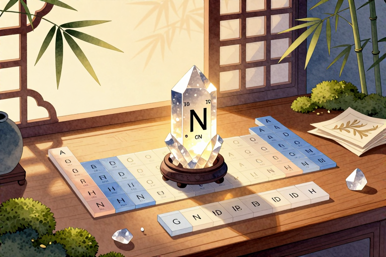

# 砹有什么特点

砹的核心特点就四个词：极度稀少、强烈放射、寿命极短、偏向金属。它在自然界里从不以独立形态存在，只能依附于铀和钍的衰变链中微量生成，且随时都在变成其他元素。

## 地壳中究竟还剩多少量

把地球当作一个巨大的原子转换车间，砹就是其中最短暂的那个过客。它并非凭空出现，而是天然铀矿和钍矿石在漫长衰变过程中偶尔掉落的产物。具体路径藏在锕系衰变链里，铀元素一步步释放粒子、改变质量数，最终有一小段分支会生成砹的同位素。这种自然合成机制决定了它的分布完全受控于母体元素的丰度与半衰期。

全球地壳中同一时刻存在的游离态或化合物态砹总量，估算不到一克。这个数字不是实验室推算的幻想值，而是基于铀矿浓度、衰变分支比例和同位素寿命叠加出来的自然平衡结果。生成速率等于消失速率，动态守恒维持着这个微乎其微的数字。你很难在某个矿区找到它富集的地层，因为每一颗新生成的砹原子都在极短时间内完成蜕变，根本来不及在地壳裂隙或矿物晶格中沉淀聚集。

## 为什么总是一闪而过

放射性是定义砹存在方式的第一性原理。所有已知的砹同位素都不稳定，最长寿的砹二百一十也只有八小时左右的半衰期。这意味着哪怕你瞬间合成出毫克级的样品，几个小时后它的质量会减半，十几个小时后几乎全部转化为钋、铋或铅的同位素混合物。原子核内部的质子中子比例偏离了稳定谷，强相互作用与电磁斥力无法达成平衡，只能靠持续释放阿尔法粒子或发生电子捕获来寻找新的构型。

这种快速衰减直接导致了“自毁”现象。当微量砹被浓缩到可观测程度时，它自身辐射出的能量会迅速加热周围物质，打断化学键，甚至使容器内壁产生微观损伤。高浓度下无法维持稳定状态，低浓度下又淹没在背景衰变噪音里。实验室里通常用同位素分离技术从辐照靶材中提取极微量的砹离子，整个操作必须在铅玻璃屏蔽与远程机械臂配合下完成。刚拿到手的样品还没来得及称重记录，就已经开始变成其他元素的混合物。

## 化学性质究竟多怪异

周期表第七主族卤素家族原本以活泼非金属著称，氟氯溴碘按规律递变，砹本该是这条序列的终点。但电子层结构的重力效应让它偏离了传统预期。第六周期的重元素内层电子运动速度逼近光速，轨道收缩导致外层价电子屏蔽不完全，有效核电荷增大。这种相对论性修正使砹的第一电离能下降，电负性降低，金属性倾向显著上升。

实际反应中它能表现出类阳离子行为，在特定溶剂里更容易失去最外层电子形成正一价或正三价络合物。挥发性低于碘单质，熔点沸点预测值明显偏高，晶体结构更接近半导体而非典型分子晶体。二聚体At2的键能较弱，受热极易解离成原子态。溶液中的氧化还原电位也发生偏移，亲核取代反应速率比卤素常规规律慢得多。教科书里的族内递变律到这里必须加入相对论修正项，否则无法解释它为何更像一块易碎的暗色金属薄片，而不是容易升华的紫黑色晶体。

## 为何没法做成实物标本

观测壁垒主要来自辐射损伤与同位素纯度要求。砹的同位素半衰期差异巨大，短寿命成员释放的高能射线会快速破坏玻璃器皿硅氧网络结构，使容器变暗、脆化甚至微裂。普通提纯手段无法分离出单一同位素，混合样品在测量过程中成分比例持续漂移，导致密度、折射率、光谱特征等物理数据始终处于动态变化中。

自然科普的价值不在于把它装进标本瓶陈列，而在于它提醒我们物质世界并非静态堆砌。元素周期表的每一个格子背后都藏着衰变动力学与量子力学的精密博弈。砹的存在方式本身就是一种流动的自然现象：从母核裂变到子体生成，原子序数在微观尺度不断更迭。理解它的特性，就是理解自然界如何通过不稳定性维持宏观稳定。

---

- 本站：[https://zlaiw.com/](https://zlaiw.com/)
- 本文 GitHub Pages 页面：https://zlaiw.github.io/zlaiw-archive/pages/%e7%a0%b9%e6%9c%89%e4%bb%80%e4%b9%88%e7%89%b9%e7%82%b9.html
