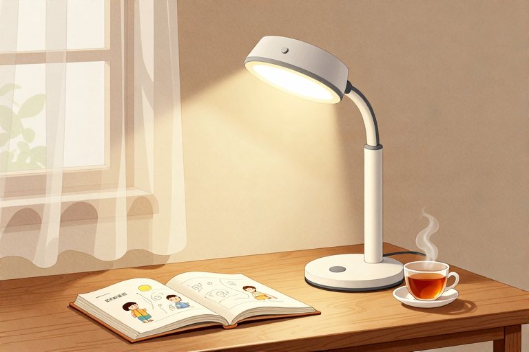

# 护眼灯买什么色温

0到6岁宝宝使用护眼灯，首选4000K左右的色温。这个数值对应的光线呈现出柔和的暖白色，既不像低色温那样偏黄容易让人昏沉，也不像高色温那样泛蓝刺眼。挑对色温只是第一步，灯光照进眼睛的那一瞬间，才是真正考验家长功课的时候。

## 婴儿期选灯要注意什么

婴儿期护眼灯不必追求高亮度，低照度、大角度的漫反射光源才是关键。宝宝出生后的视觉神经还在快速搭建中，视网膜对强光极其敏感。色温的刻度其实源自物理上的黑体加热过程：绝对黑体从－273℃开始加温后所呈现的颜色会随着温度升高而变化。当加热到一定的温度，黑体发出的光所含的光谱成分，就称为这一温度下的色温。如果某一光源发出的光，与某一温度下黑体发出的光所含的光谱成分相同，就称为某K色温。比如100W灯泡发出的光的颜色，与绝对黑体在2527℃时的颜色相同，那么这只灯泡发出的光的色温就是：（2527+273）K=2800K。低色温偏向红黄，高色温偏向蓝白。婴儿期建议将色温控制在3000K上下，配合落地灯或床头小夜灯做环境补光即可。

- 灯光摆放避开宝宝正上方，采用侧向漫反射，让光线先打在墙面再柔和地洒下来

- 喂奶或换尿布时只开局部照明，其余空间保持昏暗，帮助宝宝建立昼夜节律

- 夜间巡视尽量使用红光或暗橙色光源，避免蓝光抑制褪黑素分泌

每个宝宝的睡眠周期和光敏感度存在个体差异。有的孩子对光线变化反应迟钝，属于正常发育节奏；有的则容易惊醒，需要更长的适应期。如果宝宝频繁出现畏光、流泪不止，或者瞳孔大小在明暗交替时明显不对称，建议及时带至眼科进行专业检查。

## 学步期灯光怎么调不刺眼

两岁到四岁宝宝活动量变大，色温需维持在4000K上下，照度则要根据距离动态调整。这个阶段孩子的瞳孔调节能力逐渐成熟，但晶状体依然透明度高，高能短波蓝光更容易穿透直达视网膜。使用这种方法标定的色温与普通大众所认为的暖冷正好相反，通常人们会感觉红色、橙色和黄色较暖，白色和蓝色较冷，而实际上红色的色温最低，然后逐步增加的是橙色、黄色、白色和蓝色，蓝色是最高的色温。4000K恰好处于黄白过渡带，既能提供清晰的视觉对比，又不会让眼睛频繁调节焦距。

- 桌面照度保持在300至500勒克斯之间，用光照计或手机测光App辅助校准

- 灯头高度距离桌面六十厘米左右，出光角度向下倾斜三十到四十五度

- 避免在纯色背景墙上开强光灯，加入浅色地毯或软包家具吸收溢散光

宝宝对光线的耐受度因人而异。有的孩子喜欢在明亮环境下搭积木，有的则习惯半昏暗的角落看书，这都属于正常的个体差异。若发现孩子经常眯眼、揉搓眼睛，或者看绘本时不自觉地把脸贴得很近，不要只靠换灯解决，应尽早排查屈光状态。

## 学龄前练字画画选多少k

四岁以后进入精细动作爆发期，护眼灯色温锁定在4000K至5000K之间，照度均匀度必须达标。这个阶段孩子开始接触涂鸦、控笔训练和手工剪裁，对色彩还原和阴影层次的要求明显提高。光源的显色指数直接决定纸张纹理和颜料色彩的呈现效果，低显色会让红色发灰、绿色发暗，长期在这种光线下练习，眼睛会不自觉地用力去辨认细节。

- 选择显色指数Ra大于90、R9大于50的产品，确保红绿黄蓝原色不失真

- 照度均匀度要求中心与边缘亮度差控制在百分之三十以内，避免明暗交界线刺眼

- 右手写字时灯放左侧，左手写字放右侧，防止手部阴影遮挡工作面

孩子的握笔姿势和专注时长会有明显差异。有的孩子坐得住，能连续涂鸦二十分钟；有的则容易疲劳，十分钟就需要休息，这都属于正常发育节奏。若宝宝频繁歪头看纸、抱怨头晕眼胀，或者颜色辨认出现持续偏差，建议就医进行视功能评估。

## 日常使用灯光有哪些误区

护眼灯不是万能盾牌，色温调对之后，距离衰减和光衰问题往往被家长忽略。光线强度随距离增加呈平方反比下降，灯离桌子越远，桌面实际获得的照度会断崖式下跌。很多家庭同时开启主灯和护眼灯，认为叠加会更亮，结果导致环境光对比度过大，瞳孔频繁收缩扩张，反而加速视疲劳。灯光使用几年后，内部荧光粉也会自然老化，输出光谱发生偏移。

- 定期用软布擦拭灯罩内外灰尘，保持出光口通透

- 每半年用照度计复测一次桌面数值，低于标准值及时更换灯头或调整臂长

- 阅读画画时只开护眼灯，关闭天花板主光源，维持单一视觉焦点

房间面积和墙面吸光率不同，灯具的实际表现也会不一样。有的孩子对灰尘敏感，频繁眨眼属于正常防护反应；有的则习惯在光线稍暗处专注思考。若出现持续眼红、干涩流泪，或者眨眼频率异常增高，需及时就医排查干眼或过敏问题。

护眼灯的选择从来不是看参数堆砌，而是看光线如何落在孩子的桌面上。4000K左右的暖白光作为基础色温，配合合理的照度与均匀度，已经能覆盖绝大多数家庭场景。家长今天就可以做一件事：关掉客厅主灯，只开护眼灯，在孩子常用的书桌前放一张白纸，观察阴影边缘是否柔和、纸面有无刺眼光斑。调整灯臂高度直到光线平铺桌面而不直射眼睛，再搭配每天两小时的户外自然光接触，视力保护的路就走稳了。

## 常见问题

### 宝宝几个月可以开始用护眼灯？

出生后就可以使用，但初期只需低照度小夜灯。婴儿视觉神经尚未成熟，强光会刺激晶状体发育，建议六个月后再引入专用照明设备。

### 色温3000K和4000K哪个更适合？

两岁前推荐3000K左右，光线偏黄柔和；两岁后过渡到4000K，亮度提升且不易引起视疲劳。具体以孩子实际感受为准。

### 护眼灯需要和主灯一起开吗？

不需要。同时开启会导致明暗对比过大，瞳孔频繁调节反而加重负担。阅读时只保留单一局部光源即可。

### 孩子看书总揉眼睛正常吗？

偶尔疲劳揉眼属正常现象。若频繁发生且伴随畏光或流泪，可能提示照度不足或光谱偏移，需及时就医排查屈光问题。

### 护眼灯用多久需要更换？

光源荧光粉会自然老化，建议每两到三年检测一次照度和色温稳定性。数值明显下降或出现频闪时应果断更换。

⚠️ 温馨提示：本文仅作育儿知识科普，不能替代专业医生的诊断与治疗。宝宝如出现发热、腹泻、精神差等异常情况，请及时就医。

---

- 本站：[https://zlaiw.com/](https://zlaiw.com/)
- 本文 GitHub Pages 页面：https://zlaiw.github.io/zlaiw-archive/pages/%E6%8A%A4%E7%9C%BC%E7%81%AF%E4%B9%B0%E4%BB%80%E4%B9%88%E8%89%B2%E6%B8%A9.html
